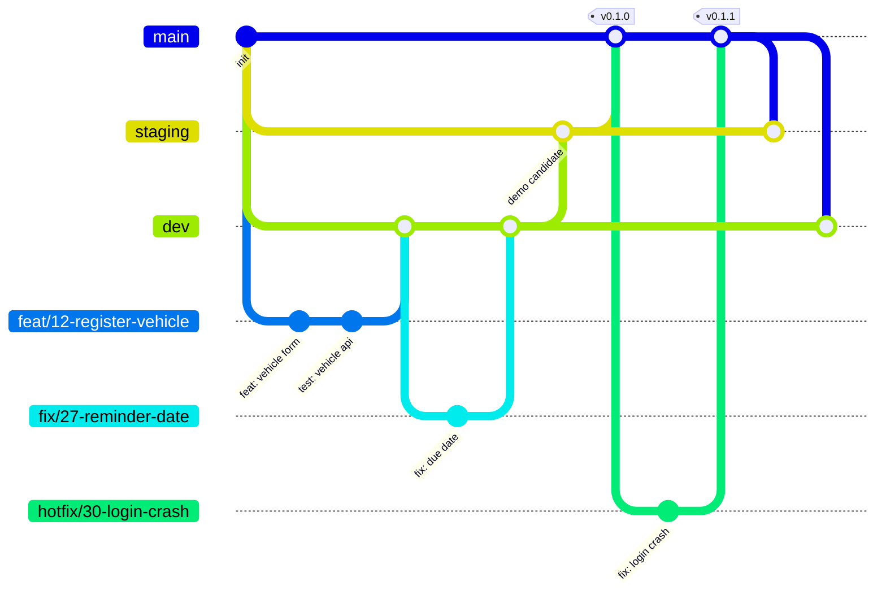

# Contributing

## Branches

| Branch | Purpose | Accepts PRs from | Protection |
|---|---|---|---|
| `main` | Production. Releases are tagged (`v0.1.0`, ...). | `staging`, `hotfix/*` | PR + 1 review + CI + branch policy |
| `staging` | Pre-production / demo candidate | `dev` | PR + 1 review + CI + branch policy |
| `dev` | Integration. **Default branch.** | work branches | PR + 1 review + CI |

Work branches start from `dev` and carry the issue number:

- `feat/12-register-vehicle`
- `fix/27-reminder-date`
- `docs/31-api-contract`
- `chore/40-bump-deps`
- `test/45-reminder-acceptance`

Hotfixes branch from `main` as `hotfix/<n>-...`, merge into `main`, then get merged back into `staging` and `dev` so the fix isn't lost on the next release.

The "accepts PRs from" rule is enforced by the `branch-policy` check ([.github/workflows/branch-policy.yml](../.github/workflows/branch-policy.yml)). GitHub branch protection can't restrict the source branch by itself.



## Workflow

1. Pick or create an issue (use a template). Note its number.
2. `git switch dev && git pull && git switch -c feat/<n>-short-name`
3. Commit with conventional commits (below). Keep PRs small.
4. Open a PR into `dev` using the template. Put `Closes #<n>` in the description.
5. Get 1 review and green CI, then **squash merge**.
6. Release: PR `dev` → `staging` (demo candidate), then PR `staging` → `main`, then tag `vX.Y.Z` on `main`.

## Commit messages

[Conventional Commits](https://www.conventionalcommits.org/): `type(scope): summary`

| Type | Use for |
|---|---|
| `feat:` | new user-facing behaviour |
| `fix:` | bug fix |
| `docs:` | documentation only |
| `test:` | tests only |
| `chore:` | tooling, deps, housekeeping |
| `ci:` | GitHub Actions / pipeline |

Examples: `feat(vehicles): add register vehicle endpoint`, `fix(reminders): use km not miles`.

## Labels

`story`, `bug`, `task`, `frontend`, `backend`, `docs`, `devops`, `blocked`, `priority:high`, `priority:medium`, `priority:low`.

---

## Admin setup (repo owner, one time)

Run from the repo root with an admin `gh` login.

### Default branch

```bash
gh repo edit ASU-MICS-2028/se-company-b-capstone --default-branch dev
```

### Branch protection

Required check names are the CI job names: `backend`, `frontend`, `branch-policy`.

> **Path-filter caveat:** CI only runs when `backend/**` or `frontend/**` changes. If a check is *required* but never runs (for example, a docs-only PR), the PR waits forever. So we don't mark `backend`/`frontend` as required, only "require branches to be up to date" plus review. Reviewers must confirm CI is green before merging. Revisit when CI becomes cheap enough to run on every PR.

```bash
REPO=ASU-MICS-2028/se-company-b-capstone

# dev: 1 review, no force-push/delete
gh api -X PUT repos/$REPO/branches/dev/protection --input - <<'JSON'
{
  "required_status_checks": null,
  "enforce_admins": false,
  "required_pull_request_reviews": { "required_approving_review_count": 1, "dismiss_stale_reviews": true },
  "restrictions": null,
  "allow_force_pushes": false,
  "allow_deletions": false
}
JSON

# staging and main: 1 review + branch-policy check (source branch rule)
for B in staging main; do
gh api -X PUT repos/$REPO/branches/$B/protection --input - <<'JSON'
{
  "required_status_checks": { "strict": true, "contexts": ["branch-policy"] },
  "enforce_admins": false,
  "required_pull_request_reviews": { "required_approving_review_count": 1, "dismiss_stale_reviews": true },
  "restrictions": null,
  "allow_force_pushes": false,
  "allow_deletions": false
}
JSON
done
```

UI equivalent: Settings → Branches → Add rule for each branch → "Require a pull request before merging" (1 approval, dismiss stale) → for `staging`/`main` also "Require status checks" → `branch-policy` → uncheck "Allow force pushes" and "Allow deletions".

### Labels

```bash
REPO=ASU-MICS-2028/se-company-b-capstone
gh label create story            -R $REPO -c 1D76DB -d "User story" --force
gh label create bug              -R $REPO -c D73A4A -d "Something is broken" --force
gh label create task             -R $REPO -c C5DEF5 -d "Technical or team task" --force
gh label create frontend         -R $REPO -c 5319E7 -d "React SPA" --force
gh label create backend          -R $REPO -c 0E8A16 -d "FastAPI service" --force
gh label create docs             -R $REPO -c 0075CA -d "Documentation" --force
gh label create devops           -R $REPO -c FBCA04 -d "CI/CD, infra, repo" --force
gh label create blocked          -R $REPO -c 000000 -d "Waiting on something" --force
gh label create priority:high    -R $REPO -c B60205 -d "Do first" --force
gh label create priority:medium  -R $REPO -c FF9F1C -d "Normal" --force
gh label create priority:low     -R $REPO -c C2E0C6 -d "Nice to have" --force
```
