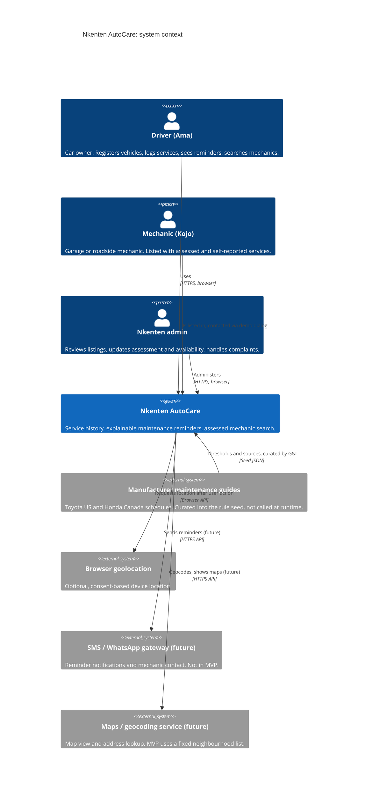
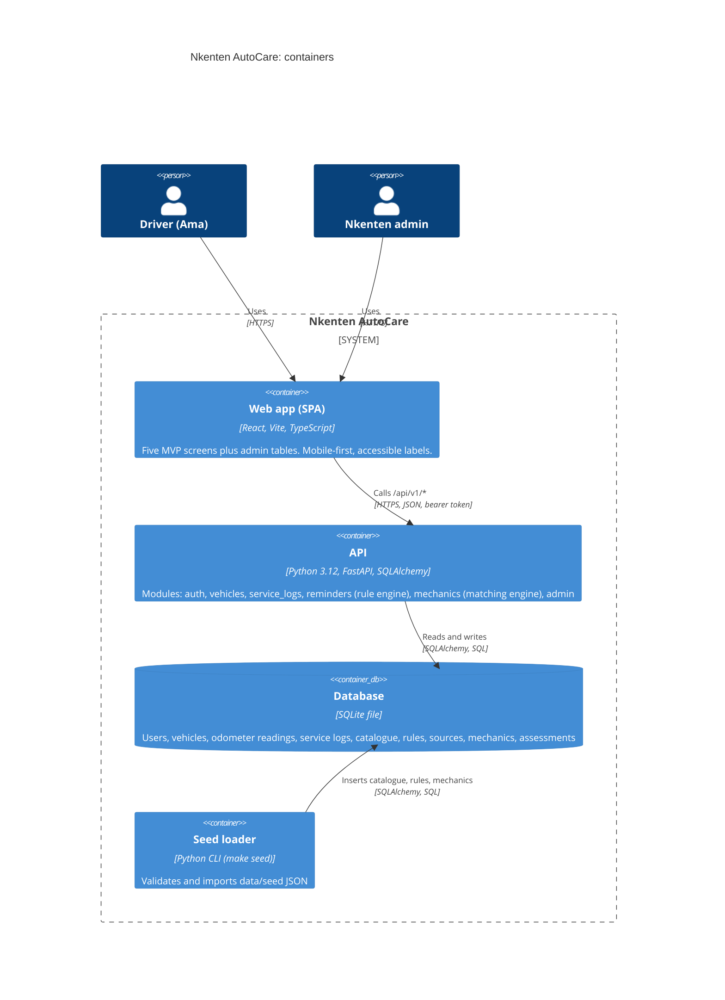
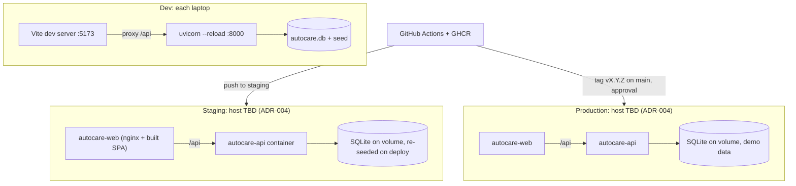

# Architecture (C4)

Diagrams use Mermaid C4 syntax so they render on GitHub. Decisions behind them are in [../adr/](../adr/).

## Level 1: System context

AutoCare is a single system used through the browser by **drivers** (persona Ama) and **admins**. **Mechanics** (persona Kojo) are listed in the system. In the MVP they don't log in: admins maintain their assessment and availability, and drivers "contact" fictional demo mechanics through a local dialog, with no real phone numbers. Maintenance thresholds come from **manufacturer guides**, but G&I curate them into `maintenance_rules.json`. The app never fetches them live. Location is either a named neighbourhood or a one-off **browser geolocation** reading, kept in memory only. SMS/WhatsApp notifications and a maps provider are marked *future* and are outside the MVP scope.

## Level 2: Containers

The **SPA** is static files. In development Vite serves them and proxies `/api` to the API; in hosted environments nginx does the same (ADR-004). Every interaction is a JSON call to the **API**, a modular monolith (ADR-001) whose modules follow router → service → repository, with the two engines kept as pure Python (ADR-002). The **reminder engine** evaluates rules against service history and odometer readings on each request. Reminder states are computed, not stored. The **matching engine** filters and ranks mechanics from one snapshot. The **SQLite** database (ADR-003) is created and filled by the **seed loader**. It loads vehicles, then rules, then mechanics, and loads mechanics only in demo and test environments.

## Deployment view

Three environments run the same code. **Dev** runs natively (or in Docker, if we adopt the bind-mounted setup) with a local SQLite file. **Staging** and **production** run the same two container images, built once in GitHub Actions and stored in GHCR. They differ only in environment variables and secrets. Staging is redeployed and re-seeded on every push to `staging`. Production only changes when a release tag on `main` is approved. Hosting is still *proposed* in ADR-004. See [../devops.md](../devops.md).
