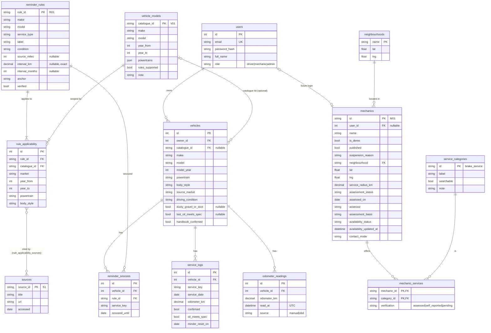

# Database schema (SQLite)

SQLAlchemy models live in `backend/app/modules/<module>/models.py` (ADR-002, ADR-003). Tables are created by `create_all()` in `app/core/db.py`. Foreign keys are enforced (`PRAGMA foreign_keys=ON`). Value lists are enforced with CHECK constraints, so a bad enum value fails at the database.

Fields marked **TODO: confirm with G&I** are guesses waiting for the rule and matching specs to be confirmed.

## Tables

| Table | Module | Purpose |
|---|---|---|
| `users` | auth | Accounts with role `driver`, `mechanic` or `admin` (#49). Passwords are stored only as a hash. |
| `vehicle_models` | vehicles | Curated catalogue (`vehicles.json`). A catalogue hit helps data entry. It does **not** enable reminders by itself. |
| `vehicles` | vehicles | An owner's car. `catalogue_id` is optional so unlisted cars (for example an Almera) can be entered manually. `source_market`, `body_style`, `powertrain` and `model_year` are what rule applicability matches on. Unknowns are stored explicitly, never guessed. |
| `odometer_readings` | service_logs | Timestamped readings. The engine treats a reading older than 30 days, or taken before the anchor service, as unknown distance. Rollback is rejected on write. `source` allows OBD-II later. |
| `service_logs` | service_logs | One row per completed service, keyed by `service_key`. A combined engine and cabin filter job is two rows, so R10's two cards age independently. Only `confirmed` rows anchor a rule. `oil_meets_spec` drives the Toyota normal-oil guard. `minder_reset_on` links a Honda Maintenance Minder reset (R09). |
| `reminder_rules` | reminders | One row per active rule (R06 is retired). `interval_km` is the **exact** threshold: Toyota rules store `source_miles × 1.609344` (16,093.44 km), not the rounded display value. A null interval means that dimension isn't used, which is different from "unknown". |
| `rule_applicability` | reminders | Exact configurations a rule covers (market, year range, powertrain, body style, catalogue row). A rule fires only on an exact match. |
| `sources`, `rule_applicability_sources` | reminders | Manufacturer documents cited by each applicability row, so every reminder can show its source. |
| `reminder_snoozes` | reminders | The only stored reminder state. **Reminder states are computed on read** by `reminders/engine.py`. "Mark done" means logging a service. |
| `service_categories` | mechanics | Mechanic search vocabulary. `ev_high_voltage` has `searchable = false`. |
| `neighbourhoods` | mechanics | Named search origins with approximate centroids. |
| `mechanics` | mechanics | Listing with overall assessment (status, date, assessor, basis), last reported availability (freshness is decided at query time, 24 h), `service_radius_km`, demo and published flags, and `suspension_reason`. |
| `mechanic_services` | mechanics | Per-service verification. An assessed mechanic can still have a self-reported skill (M01 diagnostics). |

## Seed field mapping (#35)

Checked by loading the Sprint 1 seed package into these models: every record and field loads.

| Seed file → key | Table.column | Notes |
|---|---|---|
| `vehicles.json` `vehicles[]` | `vehicle_models.*` | `rule_ids` is **not stored**. It's derived from `rule_applicability`, and the loader checks the two agree. |
| `vehicles.json` `*_values` lists | CHECK constraints on `vehicles` and `rule_applicability` | `POWERTRAINS`, `DRIVING_CONDITIONS`, `SOURCE_MARKETS`, `BODY_STYLES` in `vehicles/models.py` |
| `vehicles.json` `condition_input_note` | `vehicles.dusty_gravel_or_soot`, `vehicles.last_oil_meets_spec`, `service_logs.oil_meets_spec` | TODO: confirm with G&I |
| `maintenance_rules.json` `rules[]` | `reminder_rules.*` | `interval_km` recalculated from `source_miles` when present |
| `rules[].applicability[]` | `rule_applicability.*` | `source_ids` → `rule_applicability_sources` |
| `sources{}` | `sources.*` | |
| `units`, `state_thresholds` | not stored | Engine constants (1.609344, 0.8, 1.0). The loader checks they match. |
| `retired_rule_ids` | not stored | The loader rejects a retired ID in `rules[]` |
| `mechanics.json` `service_categories[]` | `service_categories.*` | |
| `neighbourhoods[]` | `neighbourhoods.*` | |
| `mechanics[]` | `mechanics.*` | `services[]` → `mechanic_services`. `test_purpose` is kept as fixture documentation. |
| `seed_reference_time` | not stored | Fixed clock for tests (DI, ADR-005) |
| `version`, `generated`, `note`, `disclaimer` | not stored | |

## Not in the schema yet

- **Admin change history** for assessment, availability and suspension (MT-14). Add an audit table with the admin endpoints.
- **Mapping between rule `service_type` and mechanic `service_categories`**, for example `engine_oil_and_filter` → `oil_service`, so a reminder can link to a mechanic search. TODO: confirm with G&I.
- **Account deletion and retention policy** (AC-06).
