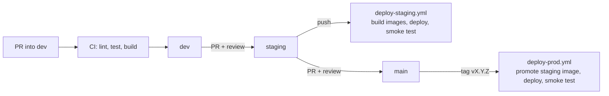

# DevOps: environments and pipeline

## Environments

| Environment | Branch | Where | Data | Purpose |
|---|---|---|---|---|
| **dev** | `dev` + work branches | Developer laptops (`make dev-backend`, `make dev-frontend`) | Local SQLite + seed data | Build and integrate features |
| **staging** | `staging` | Hosted, target TBD ([ADR-004](adr/)) | Seed / labelled demo data only | Demo candidate, class reviews, usability tests |
| **production** | `main` (tagged) | Hosted, target TBD ([ADR-004](adr/)) | Demo data for the final presentation | Final demo, 18 Dec |

Staging and production run the same Docker images and differ only in configuration (env vars and secrets).

## Pipeline

### Today (Sprint 1)

- `ci-backend.yml`: ruff, pytest (unit, api, acceptance; `@pending` skipped), coverage report, JUnit artifact.
- `ci-frontend.yml`: ESLint, `tsc` type-check, Vitest, `vite build`.
- `branch-policy.yml`: PRs into `staging` must come from `dev`; PRs into `main` from `staging` or `hotfix/*`.
- `deploy-staging.yml`, `deploy-prod.yml`: **placeholders**, manual trigger only, TODO steps.

### Planned

1. **Docker images.** `backend/Dockerfile` (uvicorn) and `frontend/Dockerfile` (`vite build` served by nginx, which also reverse-proxies `/api`). Images are pushed to GHCR (`ghcr.io/asu-mics-2028/autocare-{api,web}`), tagged `sha-<short>`.
2. **Staging deploy.** On push to `staging`: build images, push, deploy, then smoke-test `GET /api/health`.
3. **Production deploy.** On tag `vX.Y.Z` on `main`: retag the staging-tested image (no rebuild), deploy, smoke test. A GitHub Environment `production` with required reviewer approval gates it.
4. **GitHub Environments and secrets.** `staging` and `production` environments, each holding its own secrets (for example `DEPLOY_HOST`, `DEPLOY_SSH_KEY` or a platform API token, `DATABASE_URL`, `SECRET_KEY`). Secrets are never committed. `backend/.env.example` lists the variable names only.
5. **Release tagging.** After a `staging` → `main` merge: `git tag -a v0.1.0 -m "Sprint 1" && git push origin v0.1.0`. Use SemVer: minor per sprint, patch per hotfix.
6. **SQLite in hosted envs.** The DB file lives on a persistent volume and is re-seeded on staging deploys. Moving to Postgres is covered by ADR-003.

## Hosting target

TBD. Options (VPS with Docker Compose, Render/Railway, AWS) are compared in ADR-004, status *proposed*.
