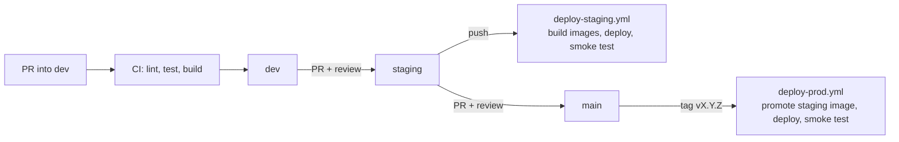

# DevOps: environments and pipeline

## Environments

| Environment | Branch | Where | Data | Purpose |
|---|---|---|---|---|
| **dev** | `dev` + work branches | Developer laptops (`make dev-backend`, `make dev-frontend`) | Local SQLite + seed data | Build and integrate features |
| **staging** | `staging` | Coolify on the team's Contabo VPS ([ADR-004](adr/004-containerised-deployment.md)) | Seed / labelled demo data only | Demo candidate, class reviews, usability tests |
| **production** | `main` (tagged) | Same Coolify server, separate app (later) | Demo data for the final presentation | Final demo, 18 Dec |

Staging and production run the same Docker images and differ only in configuration (env vars and secrets).

## Pipeline



### Today (Sprint 1)

- `ci-backend.yml`: ruff, pytest (unit, api, acceptance; `@pending` skipped), coverage report, JUnit artifact.
- `ci-frontend.yml`: ESLint, `tsc` type-check, Vitest, `vite build`.
- `branch-policy.yml`: PRs into `staging` must come from `dev`; PRs into `main` from `staging` or `hotfix/*`.
- `deploy-staging.yml`, `deploy-prod.yml`: **placeholders**, manual trigger only, TODO steps.

### Planned

1. **Docker images.** `backend/Dockerfile` (uvicorn) and `frontend/Dockerfile` (`vite build` served by nginx, which also reverse-proxies `/api`). Images are pushed to GHCR (`ghcr.io/asu-mics-2028/autocare-{api,web}`), tagged `sha-<short>`.
2. **Staging deploy.** On push to `staging`: build images, push, deploy, then smoke-test `GET /api/health`.
3. **Production deploy.** On tag `vX.Y.Z` on `main`: retag the staging-tested image (no rebuild), deploy, smoke test. A GitHub Environment `production` with required reviewer approval gates it.
4. **GitHub Environments and secrets.** `staging` and `production` environments, each holding its own secrets (for example `DEPLOY_HOST`, `DEPLOY_SSH_KEY` or a platform API token, `DATABASE_URL`, `SECRET_KEY`). Secrets are never committed. `backend/.env.example` lists the variable names only.
5. **Release tagging.** After a `staging` → `main` merge: `git tag -a v0.1.0 -m "Sprint 1" && git push origin v0.1.0`. Use SemVer: minor per sprint, patch per hotfix.
6. **SQLite in hosted envs.** The DB file lives on a persistent volume and is re-seeded on staging deploys. Moving to Postgres is covered by ADR-003.

## Hosting: Coolify on Contabo

Decided 2026-11-27 ([ADR-004](adr/004-containerised-deployment.md)). The stack is defined in [`docker-compose.yml`](../docker-compose.yml):

| Service | Image | What it does |
|---|---|---|
| `api` | `backend/Dockerfile` (Python 3.12 slim, non-root) | On start: `python -m app.seed` (validated, idempotent), then uvicorn on :8000. SQLite at `/data/autocare.db` on the `autocare-data` volume, so data survives redeploys. |
| `web` | `frontend/Dockerfile` (Node build → nginx) | Serves the SPA. Forwards `/api/*`, `/docs` and `/openapi.json` to `api`, so everything is same-origin and needs no CORS. |

### One-time Coolify setup (staging)

1. **Projects → New → Environment `staging` → New resource → Public/Private GitHub repo** `ASU-MICS-2028/se-company-b-capstone`.
2. **Build pack:** Docker Compose. **Compose file:** `/docker-compose.yml`. **Branch:** `staging`.
3. **Domain:** set it on the `web` service, port 80 (e.g. `https://autocare-staging.<domain>`). Coolify issues the certificate.
4. **Environment variables:**
   - `SECRET_KEY`: a long random string, `python -c "import secrets; print(secrets.token_urlsafe(48))"`. Required: the API refuses to start in staging without it.
   - `APP_ENV`: `staging` (default)
   - `DEMO_MODE`: `true` (default)
5. **Deploy.** Enable *Auto deploy* so every push to `staging` redeploys.

### Releasing to staging

`dev` → PR into `staging` (needs 1 review and the `branch-policy` check) → merge → Coolify redeploys. Smoke test: `https://<staging-domain>/api/health` returns `{"status":"ok",...,"db":"ok"}`, and Swagger is at `/docs`.

### Run the same stack locally

```bash
SECRET_KEY=local docker compose up --build
docker compose exec web wget -qO- http://127.0.0.1/api/health
```

Add `ports: ["8080:80"]` under `web` in a local override if you want it in the browser. The committed file only uses `expose`, so Coolify's proxy owns the ports.
